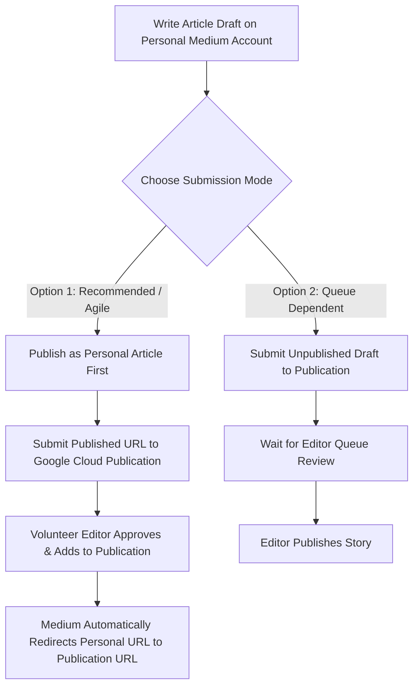
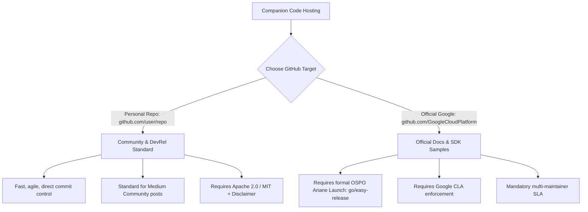
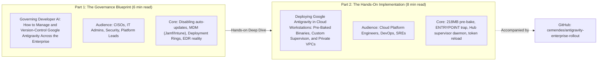

# Google Cloud DevRel Publication Playbook & Blueprint
*A standardized playbook for publishing technical articles, code companions, and LinkedIn amplifications in the style of Google Developer Relations and Cloud Advocates.*

---

## 1. Overview & Research Findings

This playbook establishes the publishing standards, format specifications ("spec/skew"), and distribution strategy for technical thought leadership produced around Google Cloud developer tooling (specifically Google Antigravity, Cloud Workstations, and Enterprise Governance).

It synthesizes official internal guidelines (`go/cloud-medium`, `go/cloudwriting`, `go/codesnippets`, `go/devrel-oss`) and proven patterns from Google Developer Advocates.

---

## 2. Platform 1: Medium (*Google Cloud - Community*)

Google Cloud runs an official community publication on Medium: [medium.com/google-cloud](https://medium.com/google-cloud) (`go/cloud-medium`). It is widely used by Googlers across DevRel, Customer Engineering (CE), Professional Services (PSO), and Technical Account Management (TAM).

### Core Publishing Rules & Anatomy

| Element | Specification & Best Practice |
| :--- | :--- |
| **Article Reading Time** | **5 to 8 minutes (~1,200 to 1,800 words)**. Articles over 10 minutes suffer a steep drop-off in completion rate. Complex topics should be split into a 2-part series. |
| **Tone & Style** | **First-person technical narrative** ("Here is the real-world challenge we faced and how we engineered a solution"). Avoid corporate marketing fluff. Focus on architecture, lessons learned, and pragmatic trade-offs. |
| **Display Title & Subtitle** | Medium uses the subtitle as the search snippet and social card preview. Always set a custom display title and subtitle via Medium's three-dot menu (*"Change display title / subtitle"*). |
| **Lead Image** | Must have an eye-catching, high-resolution header image (16:9 ratio) positioned right below the title/subtitle. Attribute the image source properly. |
| **Paywall Prohibition** | **Never enable the Medium Partner Program paywall** (`make my story eligible` must be **unchecked**). Google Cloud content must be freely accessible to all developers. |
| **Code Snippet Etiquette** | **Never dump 100+ line scripts into the article body.** Use short, focused 10–25 line syntax-highlighted snippets illustrating the "aha!" moment, and link directly to the companion GitHub repository for full files. |
| **Internal Links Policy** | **Strictly zero `go/` links or internal bug IDs.** Convert all internal references to public documentation (`cloud.google.com/...`) or public GitHub repos. |

### Submission & Approval Workflow (`go/cloud-medium`)

Google Cloud Medium operates on two ingestion workflows:



* **Recommended Flow (Option 1)**: Publish the article on your personal Medium profile first. Once live, click the story options and select **"Add to publication" &rarr; "Google Cloud"**. Once approved by the volunteer editorial team (`cloud-medium-editors@google.com`), Medium seamlessly attaches the publication banner and updates the URL without breaking existing links or claps.

---

## 3. Platform 2: GitHub Repository Standards

### Personal vs. Official Google GitHub Organizations

A critical question for Google authors: *Should code live in a personal GitHub repo or an official Google organization?*



### Why Personal GitHub Repos are the DevRel Medium Standard
1. **Agility**: Official repositories under `github.com/GoogleCloudPlatform` require a formal Open Source Program Office (OSPO) review (`go/easy-release`), CLA bot enforcement, and designated long-term team maintainers (`go/gcp-github`). They are reserved for official SDKs and doc quickstarts.
2. **Community Norm**: DevRel engineers, CEs, and architects regularly host sample architectures, opinionated Terraform modules, and tutorial companions in their personal public GitHub accounts (e.g., `github.com/cemendes/antigravity-enterprise-rollout`).
3. **Mandatory Repository Hygiene**:
   * **License**: Include an official open-source license file (Apache 2.0 or MIT) at the repository root.
   * **Disclaimer**: Include standard Google open-source disclaimer in the `README.md`:
     > *"This is an open-source community reference architecture and is not an officially supported Google product."*
   * **Code Quality**: Clean `.gitignore`, zero hardcoded project IDs, secrets, or internal hostnames.

---

## 4. Platform 3: LinkedIn Amplification Blueprint

LinkedIn is where technical decision-makers (Platform Directors, CISOs, Staff Engineers) discover content. DevRel folks do **not** post raw 10-paragraph essays on LinkedIn. They use the **"Hook + Anchor + Bridge"** formula:

### Anatomy of a High-Engagement DevRel LinkedIn Post

```
┌────────────────────────────────────────────────────────────────────────┐
│ 1. The Contrarian / Tension Hook (Lines 1-2)                            │
│    - Highlights an industry dilemma or unexpected technical trap       │
│    - Forces the reader to click "see more"                              │
├────────────────────────────────────────────────────────────────────────┤
│ 2. The Core Problem & Solution in 3 Bullet Points (Lines 3-8)          │
│    - The Dilemma: Dev AI tools default to unmanaged auto-updates        │
│    - The Trap: 218 MB background binary download timeouts in VPCs      │
│    - The Fix: Pre-baking + OS-level policy injection                   │
├────────────────────────────────────────────────────────────────────────┤
│ 3. The Visual Anchor                                                   │
│    - 16:9 Architecture Diagram (Mermaid or Clean Cloud Architecture)   │
│    - OR a 3-4 slide PDF carousel (summarizing key architecture points) │
├────────────────────────────────────────────────────────────────────────┤
│ 4. The Bridge / CTA                                                    │
│    - Links to the Medium deep dive and the open-source GitHub repo      │
│    - 3-5 targeted hashtags (#GoogleCloud #PlatformEngineering #DevOps) │
└────────────────────────────────────────────────────────────────────────┘
```

---

## 5. The 2-Part Publication Series Plan

To maximize impact and avoid reader fatigue, we structure the Antigravity rollout into a **2-part companion series**:



---

### Part 1 Blueprint: The Governance & Strategy Post

* **Target Publication**: *Google Cloud - Community* (Medium)
* **Target Reading Time**: ~6 minutes (1,350 words)
* **Primary Persona**: CISO, Security Operations, Enterprise IT, Platform Directors
* **Title**: *Governing Developer AI: How to Manage and Version-Control Google Antigravity Across the Enterprise*
* **Subtitle**: *Why modern AI coding assistants default to continuous auto-updates, and how enterprise platform teams enforce deterministic version locking via MDM and Cloud Workstations.*

#### Article Structure & Key Sections
1. **The Tension**: Why AI coding assistants love auto-updating, and why your enterprise security and compliance teams hate it (SOC 2 change control, unexpected IDE breakages).
2. **The Strategic Choice**: Cloud Workstations (100% remote perimeter) vs. Physical Laptops via MDM (governed native desktops).
3. **The Core Fix**: Injecting OS-level machine policies (`update.mode = "none"`) that override developer user settings.
4. **Platform Blueprints**: 15-line snippets for macOS Jamf Pro (`.mobileconfig`), Windows Intune (PowerShell registry), and Linux Ansible.
5. **The Hard Reality on Local Endpoints**: Why local `sudo`/admin rights mean MDM is a guardrail, and why regulated enterprises pair it with EDR application hash whitelisting (CrowdStrike / Carbon Black).
6. **Next Steps & Call to Action**: Pointing readers to Part 2 for the hands-on Cloud Workstations implementation, and linking to the GitHub companion repo.

#### LinkedIn Amplification Copy for Part 1
```text
Developer AI tools like Google Antigravity default to continuous background auto-updates. For individual hackers, that’s great. For enterprise platform teams handling compliance, change control, and deterministic developer environments, it’s a governance headache.

If an unvetted update silently lands on 2,000 developer machines on a Tuesday morning, who validates the network egress changes? Who tests language server compatibility with your internal proxies?

In my latest article for the Google Cloud Community, I break down the enterprise governance framework for version-controlling Antigravity:

🔹 Why user-level IDE settings fail (and why OS-level administrative policies are required)
🔹 Turnkey MDM blueprints for macOS (Jamf Pro), Windows (Intune), and Linux (Ansible)
🔹 The local admin reality: When to pair MDM guardrails with EDR binary hash whitelisting
🔹 Architectural trade-offs: Local endpoints vs. Cloud Workstations immutable sandboxes

Read the full deep dive on Medium: [LINK]
Explore the production policy templates on GitHub: https://github.com/cemendes/antigravity-enterprise-rollout

#GoogleCloud #PlatformEngineering #DevOps #EnterpriseAI #CyberSecurity
```

---

### Part 2 Blueprint: The Cloud Workstations Technical Deep Dive

* **Target Publication**: *Google Cloud - Community* (Medium)
* **Target Reading Time**: ~8 minutes (1,700 words)
* **Primary Persona**: Platform Engineers, Cloud Architects, DevOps, SREs
* **Title**: *Deploying Google Antigravity in Cloud Workstations: Pre-Baked Binaries, Custom Supervison, and Private VPCs*
* **Subtitle**: *A production engineering guide to pre-baking 218 MB backend binaries, building zero-downtime token supervisors, and bypassing common container traps in private VPCs.*

#### Article Structure & Key Sections
1. **The Architecture**: Why Cloud Workstations is the gold standard for zero-exfiltration developer environments (source code never leaves the VPC).
2. **The 218 MB Download Pitfall**: Explaining the decoupled `.vsix` frontend vs. `agy` backend architecture, and why private VPCs trigger 15-second launch timeouts.
3. **The Pre-Baking Pattern**: Build-time staging in `/opt/antigravity/bin` + boot-time seeding in `/etc/workstation-startup.d/050_install_antigravity.sh` for instant 0-second boot.
4. **Two Docker Traps to Avoid**: Never override `ENTRYPOINT` (or you break user provisioning), and purge user extension overrides on boot (`999_antigravity_guard.sh`).
5. **The Hub Supervisor Daemon**: How we built an automated file-modification watcher (`antigravity-hub-supervisor.sh`) to detect CLI OAuth writes and reload the Hub on port `41969` without touching developer workflows.
6. **Known Platform Nuances**: The Code-OSS iframe CSP limitation (`b/563594437`) and the dual-tab browser workflow.
7. **Production Code**: Full Terraform and Docker recipes available in the companion repo.

#### LinkedIn Amplification Copy for Part 2
```text
Running AI coding agents in private enterprise VPCs sounds great until you hit real-world platform plumbing:

1. The editor extension tries to dynamically pull a 218 MB backend binary on startup, blowing through a 15-second timeout in restricted networks.
2. Custom container ENTRYPOINT scripts silently break Cloud Workstations user provisioning.
3. Language server daemons cache credentials in memory, ignoring new OAuth tokens created during CLI authentication.

In Part 2 of our Antigravity enterprise rollout series, we walk through the engineering solutions to deploy Google Antigravity in Cloud Workstations with zero friction:

⚡ Pre-baking the 218 MB runtime binary for instant 0-second launches
⚡ Building a lightweight background supervisor daemon to auto-reload credentials on token refresh
⚡ Enforcing machine-level lockdown policies that survive persistent SSD reboots
⚡ A validated CLI-first onboarding flow for developers

Check out the technical walkthrough on Medium: [LINK]
Grab the production Terraform & Docker manifests on GitHub: https://github.com/cemendes/antigravity-enterprise-rollout

#GoogleCloud #CloudWorkstations #Terraform #DevSecOps #SoftwareEngineering
```
