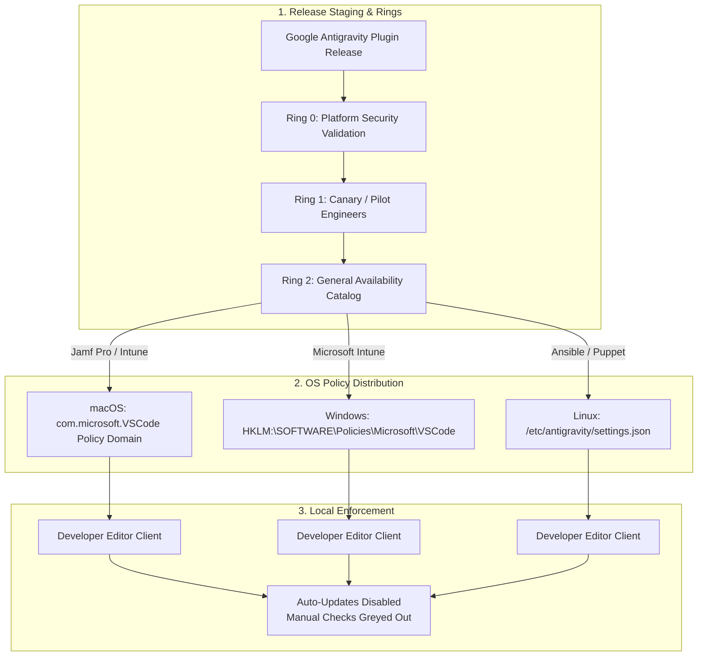

# Enterprise Version Control & Deployment Guide: Google Antigravity (AGY)
*How to deploy and version-control Antigravity 2.0 across Google Cloud Workstations and enterprise MDM.*

---

## 1. Executive Summary & TL;DR

### Executive Summary

The goal of this document is to show you how to securely deploy and manage Google Antigravity 2.0 (AGY) across your organization. 

By default, developer tooling often relies on continuous background updates. In enterprise environments, however, unmanaged client updates can disrupt compliance, break developer environments, or violate internal change control policies. To solve this, we recommend two deployment models that give you complete version control:

1. **Local Desktop via Enterprise MDM**: Deploy Antigravity 2.0 to physical developer machines using your existing Mobile Device Management (MDM) fleet tooling (such as Jamf Pro, Microsoft Intune, or Ansible). By applying system-level configuration policies, you disable background auto-updates and lock Antigravity to an IT-approved version that fits your corporate governance and data security standards.
2. **Google Cloud Workstations**: Provision remote developer workstations on Google Cloud with the approved Antigravity version pre-baked into a custom container image. Auto-updates are completely disabled inside the workstation environment, giving your platform team deterministic control over exactly when and how new versions are promoted to users.

> [!NOTE]
> **Enterprise Scope & Compliance Notice**:  
> This guide covers enterprise deployment and version control of Antigravity 2.0 (AGY) across **Google Cloud Workstations**, the official **VS Code extension**, and the official **JetBrains plugin**. It specifically **does not cover the standalone Antigravity IDE application**, which is a consumer preview product and is not covered under the Google Cloud Business Associate Agreement (BAA) or enterprise commercial terms.

> [!IMPORTANT]
> ### Executive TL;DR
> * **The Core Dilemma**: Developer AI tools default to continuous auto-updates, conflicting with enterprise change control, compliance standards, and deterministic build environments.
> * **Path 1 (Cloud Workstations — Recommended for High Security & Contractors)**: Guarantees 100% data and code perimeter isolation in a private or restricted VPC (whether using Private Google Access, Cloud NAT, or an enterprise egress proxy). New versions are promoted via Infrastructure-as-Code (Terraform + Artifact Registry container tags).
> * **Path 2 (Local MDM — Recommended for Core FTEs Requiring Offline Mobility)**: Manages physical developer laptops across macOS, Windows, and Linux via Jamf Pro, Microsoft Intune, and Ansible. Injects OS-level administrative policies (`update.mode = "none"`) that override local user configurations.
> * **Backend Hub Timeout Fix**: Antigravity decouples the editor `.vsix` from a **218 MB** backend binary (`agy`). Pre-baking this binary into the container and seeding it via `/etc/workstation-startup.d/` prevents dynamic download timeouts in private networks.
> * **Endpoint Admin Rights Reality**: On local laptops where developers have `sudo` / admin access, MDM policies act as managed guardrails. For strict tamper-proof boundaries, pair MDM with EDR application hash whitelisting (CrowdStrike / Carbon Black).

### Video Walkthrough & Demo (TBD)
<!-- TODO: Insert video embed or link (YouTube / Google Drive / Loom) -->
> [!NOTE]
> **Video Walkthrough**: *TBD — Production video walkthrough link will be added upon final release.*  
> *Walkthrough showing workstation lifecycle updates, policy enforcement, and the backend hub setup.*

### GitHub Repository
> [!TIP]
> **Production Code & Terraform Modules**:  
> Complete Terraform modules, Dockerfile configurations, startup hooks, and MDM profile payloads are maintained at:  
> **[github.com/cemendes/antigravity-enterprise-rollout](https://github.com/cemendes/antigravity-enterprise-rollout)**

---

## 2. Strategic Decision Matrix: Choosing Your Deployment Path

Enterprise platform teams and security teams face a clear choice when rolling out Antigravity:

* **Cloud Workstations (Immutable Remote Sandboxes)**: Zero source code and no model outputs ever touch physical employee laptops. Everything executes inside a hardened, private or restricted VPC.
* **Local Laptops via Enterprise MDM (Governed Native Desktops)**: Antigravity runs directly on developer hardware across macOS, Windows, and Linux through official enterprise editor plugins:
  * **VS Code Extension**: First-party extension (`Google.google-antigravity`) for teams standardized on Microsoft VS Code.
  * **JetBrains Plugin**: Official plugin on the JetBrains Marketplace for developers using IntelliJ IDEA, Android Studio, PyCharm, WebStorm, and GoLand.
  * Both plugin surfaces can be governed centrally through Jamf Pro, Microsoft Intune, or Ansible.

---

### Core Comparison Dimensions

| Dimension | Google Cloud Workstations | Local Laptops via Enterprise MDM |
| :--- | :--- | :--- |
| **Data Governance & Exfiltration** | **100% Perimeter Isolation**. The developer's machine operates purely as a display terminal. Source code, secrets, and agent interactions remain strictly within your Google Cloud perimeter. <br/><br/>*Note on Clipboard Restriction*: Cloud Workstations does not include a native toggle to block copy/paste; enforcing clipboard isolation requires configuring [BeyondCorp Enterprise Threat and Data Protection](https://cloud.google.com/beyondcorp-enterprise/docs/protect-sensitive-data) or Chrome Enterprise DLP policies. | **Shared Boundary**. Source code and configuration files reside on physical local drives. If developers have `sudo` or local administrator rights, client-side configuration policies are managed guardrails that can be bypassed—unless paired with strict EDR application hash whitelisting. |
| **Environment Determinism** | **Bit-for-Bit Identical**. Every developer runs from an immutable container image hosted in Artifact Registry. Toolchains, extensions, and configurations are guaranteed consistent across the fleet. | **Fleet Variation**. Prone to configuration drift across operating system versions, local environment variables, and user-level customizations. |
| **Mobility & Offline Access** | **Always-Connected**. Requires an active internet connection to access the remote workstation instance. | **Hybrid Offline**. Developers can view, edit, and compile code locally without internet. However, **all Antigravity AI capabilities (reasoning, chat, and agent execution) require an active internet connection** to query Google Cloud models; AGY cannot be routed to local LLMs. |
| **Operational & Change Management** | **Managed as Code (IaC)**. Managed via Terraform and Cloud Build. Releasing an update means publishing a new container tag to Artifact Registry, updating the workstation configuration, and cycling instances. | **Centralized IT Policies**. Managed by corporate IT via `.mobileconfig` profiles, Intune PowerShell remediation scripts, and phased deployment rings. |

---

### How to Decide

* **Choose Cloud Workstations if**: You are provisioning environments for contractors, offshore development teams, or projects handling high-value intellectual property, sensitive financial/healthcare data, or regulated compliance workloads that prohibit corporate code on endpoints.
* **Choose Local MDM if**: You are supporting full-time core engineers who need local editor workflows, and whose physical endpoints are already protected by robust Endpoint Detection and Response (EDR) agents.

---

## 3. Path 1: Cloud Workstations (Immutable Remote Sandboxes)

Google Cloud Workstations provides a fully managed, browser-accessible or SSH-accessible remote development environment running on Google Cloud infrastructure. If you need strict version control, code privacy, and data isolation, this is our recommended setup.

```mermaid
graph TD
    subgraph "1. Network & Security Perimeter"
        VPC[Custom VPC: workstation-vpc] --> Subnet[Subnet: workstation-subnet<br/>Private Google Access Enabled<br/>disable_public_ip_addresses = true]
        IAM[IAM Roles: storage.objectUser, artifactregistry.reader]
    end

    subgraph "2. Container Build Pipeline"
        Docker[Dockerfile + machine-settings.json] --> CB[Google Cloud Build / GitHub Actions]
        CB --> AR[Artifact Registry: workstation-images<br/>agy:1.5.0]
    end

    subgraph "3. Workstation Infrastructure"
        Subnet --> Cluster[Workstation Cluster: enterprise-agy-cluster]
        Cluster --> Config[Workstation Config: agy-linux-stable<br/>Shielded VM + Attached SA]
        AR -.->|Pulls Private Container| Config
    end

    subgraph "4. Developer Runtime & Startup Lifecycle"
        Config --> WS[Developer Workstation: dev-user]
        WS --> StartupHook[/etc/workstation-startup.d/050_install_antigravity.sh<br/>Seeds ~/.gemini/bin/agy before Code-OSS boots]
        WS --> SupervisorDaemon[/usr/local/bin/antigravity-hub-supervisor.sh<br/>Maintains :41969 Hub loop & monitors token file]
        WS --> GuardHook[/etc/workstation-startup.d/999_antigravity_guard.sh<br/>Purges local extension overrides on boot]
        WS --> MachinePolicy[/opt/code-oss/data/Machine/settings.json<br/>update.mode=none]
        WS --> PersistentHome[(Persistent SSD: /home/user)]
    end
```

---

### The 2-Tier Runtime Architecture & Pre-Baking Strategy

Antigravity operates across two distinct components in Cloud Workstations:

1. **Frontend Extension Bridge (`.vsix`)**: Installed inside the editor (`google.antigravity`), providing the UI sidebar, chat panels, and inline code suggestions.
2. **Backend Hub Process (`~/.gemini/bin/agy`)**: A native binary that handles the core agent runtime, code parsing, and secure connection to Google Cloud.

#### The Pre-Baking Strategy
If the backend binary `~/.gemini/bin/agy` is absent when the extension launches, the extension attempts to download a 218 MB archive dynamically. In restricted enterprise VPCs without open public egress, this dynamic download fails to finish within the extension's 15-second budget.

We solve this cleanly in the architecture by pre-baking:
* **Container Build Time**: Download and stage the verified `agy` backend binary inside `/opt/antigravity/bin/agy`.
* **Workstation Startup Hook (`050_install_antigravity.sh`)**: On boot, Cloud Workstations runs `/etc/workstation-startup.d/050_install_antigravity.sh`, which seeds `/opt/antigravity/bin/agy` into `/home/user/.gemini/bin/agy` before Code-OSS starts.
* **Instant Activation**: The extension detects the existing binary on launch and boots immediately with **zero download latency**.

---

### Deployment Options: Greenfield vs. Brownfield

#### Option A: Greenfield (Deploy from Scratch)
If you are standing up new Cloud Workstations environments, use our turnkey Terraform module and reference Dockerfile available at [github.com/cemendes/antigravity-enterprise-rollout](https://github.com/cemendes/antigravity-enterprise-rollout). This provisions the VPC, Private Google Access, Artifact Registry, workstation cluster, and hardened workstation configuration end-to-end.

#### Option B: Brownfield (Adding Antigravity to Existing Workstations)
If your organization already has custom workstation base images and configurations running for developers, you do not need to replace your infrastructure. You can add Antigravity directly to your existing workstation container image and configuration:

**1. Add Antigravity to your existing `Dockerfile`**:
```dockerfile
# Staging Antigravity extension and backend hub
ARG AGY_VERSION="1.2.5"
RUN mkdir -p /opt/antigravity/bin /etc/workstation-startup.d && \
    curl -fsSL -o /tmp/antigravity.vsix "https://storage.googleapis.com/antigravity-releases/extensions/google.antigravity-${AGY_VERSION}.vsix" && \
    code-oss --install-extension /tmp/antigravity.vsix && rm /tmp/antigravity.vsix && \
    curl -fsSL "https://storage.googleapis.com/antigravity-releases/cli/linux_x64/agy-${AGY_VERSION}.tar.gz" | tar -xz -C /opt/antigravity/bin/ && \
    chmod +x /opt/antigravity/bin/agy
```

**2. Copy the startup hooks into `/etc/workstation-startup.d/`**:
```dockerfile
COPY scripts/050_install_antigravity.sh /etc/workstation-startup.d/050_install_antigravity.sh
COPY scripts/999_antigravity_guard.sh /etc/workstation-startup.d/999_antigravity_guard.sh
RUN chmod +x /etc/workstation-startup.d/*.sh
```

**3. Update your existing Terraform workstation config (`workstation_config.tf`)**:
```hcl
# variables.tf
variable "workstation_image_tag" {
  type        = string
  description = "Container image tag for the custom workstation image in Artifact Registry"
  default     = "v1.6.0"
}

# workstation_config.tf
resource "google_workstations_workstation_config" "existing_config" {
  workstation_cluster_id = var.existing_cluster_id
  workstation_config_id  = "dev-linux-default"
  location               = var.region

  # Retain your existing host, hardware, and persistent directory settings:
  host {
    gce_instance {
      machine_type                = "e2-standard-8"
      disable_public_ip_addresses = true
    }
  }

  persistent_directories {
    gce_pd {
      size_gb        = 200
      disk_type      = "pd-balanced"
      reclaim_policy = "RETAIN"
    }
    mount_path = "/home/user"
  }

  # Point to your updated image parameterized via variable:
  container {
    image = "us-central1-docker.pkg.dev/${var.project_id}/workstations/custom-dev-image:${var.workstation_image_tag}"
  }
}
```

---

### Enterprise Lockdown Policy: Disabling Auto-Updates

To ensure users cannot inadvertently update Antigravity or drift from the corporate-mandated version, two enforcement mechanisms are baked into the container:

#### 1. Machine-Level Settings (`machine-settings.json`)
Placed at `/opt/code-oss/data/Machine/settings.json`, overriding user-level settings:
```json
{
  "update.mode": "none",
  "extensions.autoCheckUpdates": false,
  "extensions.autoUpdate": false,
  "app.autoCheckUpdates": false
}
```

#### 2. Startup Guard Hook (`999_antigravity_guard.sh`)
Placed in `/etc/workstation-startup.d/999_antigravity_guard.sh`:
```bash
#!/bin/bash
# Executed automatically on workstation boot
echo "[Antigravity Guard] Purging user-installed extension overrides..."
rm -rf /home/user/.vscode-oss/extensions/google.antigravity-* 2>/dev/null || true
rm -rf /home/user/.vscode/extensions/google.antigravity-* 2>/dev/null || true
```

---

### Operational Lifecycle: How IT Releases Updates

Upgrading Antigravity in this model is deterministic, audited, and automated via standard CI/CD. The deployment follows a tool-agnostic contract:

#### 1. Discover and Verify the Latest Release
Before building a new container image, platform teams inspect the latest approved Antigravity release:

* **Query the Official Release Channel**:
  ```bash
  # Check the latest release metadata manifest
  curl -fsSL https://storage.googleapis.com/antigravity-releases/latest.json | jq .

  # Or query the latest CLI version string directly
  curl -fsSL https://storage.googleapis.com/antigravity-releases/cli/latest_version.txt
  ```
* **Review Official Release Notes**: Consult [cloud.google.com/antigravity/docs/release-notes](https://cloud.google.com/antigravity/docs/release-notes) to review new features, breaking changes, and CVE patches.
* **Inspect Current Running Fleet Version**:
  ```bash
  # Check the version currently active in your Artifact Registry image
  docker run --rm us-central1-docker.pkg.dev/${PROJECT_ID}/workstations/custom-dev-image:${CURRENT_TAG} /opt/antigravity/bin/agy --version
  ```

#### 2. Build & Stage Container Image
Update the `ARG AGY_VERSION="<version>"` in your Dockerfile, pre-baking the new `.vsix` extension and `/opt/antigravity/bin/agy` backend binary.

#### 3. Push to Artifact Registry
Authenticate and push the tagged image to your private Artifact Registry repository:
```bash
docker push us-central1-docker.pkg.dev/${PROJECT_ID}/workstations/custom-dev-image:${NEW_TAG}
```

#### 4. Update Workstation Config via Terraform
Promote the new image version across the fleet by updating the `workstation_image_tag` variable in `terraform.tfvars` or via CI/CD pipeline parameters:
```bash
terraform apply -var="workstation_image_tag=v1.6.0"
```

#### 5. Cycle Workstations
When developers restart their workstations at the end of the day (or during a scheduled maintenance window), the Cloud Workstations service pulls the new image container tag. Their code in `/home/user` persists intact on their persistent SSD, while the underlying OS, extensions, and Antigravity binaries seamlessly step up to the new approved version.

#### 6. Developer Access Models & Workflows

Once deployed, developer teams connect to their workstation environment using one of three validated pathways:
* **Option A: Browser-Only (Zero Local Footprint)**:
  * Open Code-OSS for coding and terminal access: `https://<workstation>.<cluster>.cloudworkstations.dev/?authuser=0`
  * Open the Standalone Antigravity Web Hub side-by-side: `https://41969-<workstation>.<cluster>.cloudworkstations.dev/?authuser=0`
  * Delivers 100% functionality for authentication, agentic chat, code reviews, and diff inspection directly in the browser.
* **Option B: Native Desktop IDE via Secure Tunnel**:
  * Tunnel SSH (Port 22) or the Hub (Port 41969) to the local laptop:
    ```bash
    gcloud workstations start-tcp-tunnel <workstation-name> 22 \
      --cluster=<cluster-name> --config=agy-linux-stable --region=<region>
    ```
  * Connect local Desktop VS Code / Antigravity via Remote - SSH; the sidebar webview functions natively without browser iframe sandbox restrictions.
* **Option C: Antigravity CLI (`agy`) Terminal Access**:
  * **Pre-Installed & Pre-Configured**: The CLI binary (`agy`) is globally installed at `/usr/local/bin/agy` (in system `$PATH`) and pre-symlinked to the user's OAuth token on boot.
  * **From Code-OSS Terminal**: Press `Ctrl + \`` inside the browser IDE and run `agy` for an interactive agent terminal, or `agy -p "prompt"` for non-interactive execution.
  * **From Native Laptop Terminal**: SSH directly into the workstation from macOS/Linux terminal using `gcloud workstations ssh <workstation-name> --cluster=<cluster> --config=agy-linux-stable --region=<region>` and run `agy`.

#### 7. Recommended Developer Onboarding Sequence (CLI-First + Auto-Reloading Hub Pattern)

Because Cloud Workstations operates behind Google Cloud's web preview reverse proxy, OAuth loopback redirects cannot post directly to the remote container browser session without manual token copy. The validated, 100% reliable onboarding flow is:

1. **Step 1 — Deploy / Start Workstation**: The workstation instance starts with the custom container and mounts the persistent `/home` SSD.
2. **Step 2 — Run CLI Login**: The developer accesses Code-OSS (`https://<workstation>.<cluster>.cloudworkstations.dev/?authuser=0`), opens the terminal (`Ctrl + \``), and runs:
   ```bash
   agy
   ```
   Select **Log In** &rarr; **Google Account**.
3. **Step 3 — Consent & Paste Code**: Open the generated OAuth URL in a browser tab, authorize using the corporate Google account (`@yourcompany.com`), and copy the final redirected URL (containing `auth_code`). Paste it back into the CLI prompt.
4. **Step 4 — Automated Hub Reload (Zero Extra Steps)**:
   * The CLI writes credentials to `/home/user/.gemini/jetski-standalone-oauth-token`.
   * Within 2 seconds, the container's background **Hub Supervisor** (`/usr/local/bin/antigravity-hub-supervisor.sh`) detects the new token `mtime`.
   * It terminates the unauthenticated Hub daemon (`pkill -f 'agy.*--hub'`), and the auto-respawn loop restarts the Hub on port `41969` with the new token loaded (`gcp-ge-plus-tier`).
5. **Step 5 — Open Antigravity Standalone UI**: Open `https://41969-<workstation>.<cluster>.cloudworkstations.dev/?authuser=0` in a side-by-side browser tab. The web app is fully logged in and ready for agent development.


#### 8. Token Lifecycle & Expiration Dynamics

* **Access Token Lifespan (1 Hour)**: The active OAuth 2.0 Bearer access token expires after **60 minutes** (`3,600 seconds`).
* **Refresh Token Lifespan (Long-Lived / Indefinite)**: The token payload contains a persistent `refresh_token`. Under standard Google Cloud & Workspace OAuth, refresh tokens remain valid indefinitely until manually revoked or governed by corporate Google Workspace Admin Session Duration policies (typically 14 to 30 days, or exempt for managed devices).
* **Silent Background Refresh**: Both the Antigravity Web Hub daemon and the `agy` CLI automatically detect when the access token is near expiry and perform a silent background refresh using the stored `refresh_token`. Developers are never interrupted during coding or agent executions.
* **Persistence Across Container Reboots**: Because `jetski-standalone-oauth-token` resides on the persistent `/home` SSD disk, the refresh token survives all container rebuilds, workstation stops, and daily maintenance reboots.

> [!TIP]
> **Plugging in Your CD Tool of Choice**:  
> While our reference repository provides `cloudbuild.yaml` as a ready-to-run Google Cloud native pipeline, the deployment pattern is completely CI-agnostic. Whether your team uses **Cloud Build**, **GitHub Actions**, **GitLab CI**, or **Jenkins**, the pipeline only needs permission to push to Artifact Registry (`roles/artifactregistry.writer`) and run `terraform apply`.

---

## 4. Path 2: Physical Laptops via Enterprise MDM

For organizations that support developer mobility and local development workflows, Antigravity 2.0 (AGY) editor plugins can be deployed and governed directly on physical developer laptops across macOS, Windows, and Linux using enterprise Mobile Device Management (MDM) platforms such as Jamf Pro, Microsoft Intune, and Ansible.



---

### System-Level Policies Override User Settings

When deploying to local developer machines, never rely on user-level configuration files (such as `~/.config/Code/User/settings.json` or `%APPDATA%`), because developers can easily modify, overwrite, or delete them.

Instead, enterprise MDM pushes configuration payloads into **system-level administrative policy stores**. When policies are enforced at the machine layer, the operating system prioritizes them over any user-level settings. In the Antigravity UI, auto-update checkboxes and manual update checks are greyed out and locked to the administrator's configuration.

---

### Platform Implementation Blueprints

#### 1. macOS: Jamf Pro / Microsoft Intune (`.mobileconfig`)
Deploy a configuration profile payload targeting the application preference domain:
```xml
<?xml version="1.0" encoding="UTF-8"?>
<!DOCTYPE plist PUBLIC "-//Apple//DTD PLIST 1.0//EN" "http://www.apple.com/DTDs/PropertyList-1.0.dtd">
<plist version="1.0">
<dict>
    <key>PayloadContent</key>
    <array>
        <dict>
            <key>PayloadType</key>
            <string>com.microsoft.VSCode</string>
            <key>PayloadIdentifier</key>
            <string>com.company.antigravity.policy</string>
            <key>PayloadUUID</key>
            <string>4F2A1C3E-9B8D-4E7A-A123-8B7C9D0E1F2A</string>
            <key>PayloadVersion</key>
            <integer>1</integer>
            <key>PayloadEnabled</key>
            <true/>
            <!-- Disable Application & Extension Auto Updates -->
            <key>update.mode</key>
            <string>none</string>
            <key>extensions.autoCheckUpdates</key>
            <false/>
            <key>extensions.autoUpdate</key>
            <false/>
            <key>app.autoCheckUpdates</key>
            <false/>
        </dict>
    </array>
    <key>PayloadDisplayName</key>
    <string>Antigravity Enterprise Policy</string>
    <key>PayloadIdentifier</key>
    <string>com.company.antigravity.profile</string>
    <key>PayloadType</key>
    <string>Configuration</string>
    <key>PayloadUUID</key>
    <string>1A2B3C4D-5E6F-7A8B-9C0D-1E2F3A4B5C6D</string>
    <key>PayloadVersion</key>
    <integer>1</integer>
</dict>
</plist>
```

#### 2. Windows: Microsoft Intune PowerShell / ADMX Registry Policy
Deploy via Intune Proactive Remediation or Win32 app package to lock machine registry keys:
```powershell
$ErrorActionPreference = "Stop"

# 1. Enforce update lockdown at machine policy root
$RegPath = "HKLM:\SOFTWARE\Policies\Microsoft\VSCode"
if (!(Test-Path -Path $RegPath)) {
    New-Item -Path $RegPath -Force | Out-Null
}
Set-ItemProperty -Path $RegPath -Name "update.mode" -Value "none" -Type String
Set-ItemProperty -Path $RegPath -Name "extensions.autoCheckUpdates" -Value 0 -Type DWord
Set-ItemProperty -Path $RegPath -Name "extensions.autoUpdate" -Value 0 -Type DWord

# 2. Antigravity Desktop Specific Policy
$AgyRegPath = "HKLM:\SOFTWARE\Policies\Google\Antigravity"
if (!(Test-Path -Path $AgyRegPath)) {
    New-Item -Path $AgyRegPath -Force | Out-Null
}
Set-ItemProperty -Path $AgyRegPath -Name "autoCheckUpdates" -Value 0 -Type DWord
```

#### 3. Linux: Ansible Playbook
Deploy a root-owned, read-only configuration file at `/etc/antigravity/settings.json`:
```yaml
- name: Deploy Antigravity Machine Policy
  hosts: workstations
  become: true
  tasks:
    - name: Create system configuration directory
      ansible.builtin.file:
        path: /etc/antigravity
        state: directory
        owner: root
        group: root
        mode: '0755'

    - name: Write locked machine settings
      ansible.builtin.copy:
        dest: /etc/antigravity/settings.json
        owner: root
        group: root
        mode: '0644'
        content: |
          {
            "update.mode": "none",
            "app.autoCheckUpdates": false,
            "extensions.autoCheckUpdates": false,
            "extensions.autoUpdate": false
          }
```

---

### Release Governance & Deployment Rings

To roll out updates safely without breaking production workflows, manage client software versions through phased rings:

* **Ring 0 (Platform Security & IT)**: Test the raw release candidate binary against internal corporate proxies, TLS inspection, and VPN gateways to verify connectivity.
* **Ring 1 (Canary & Pilot Developers)**: Push to early adopter teams across engineering to validate daily workflows, language servers, and project extensions.
* **Ring 2 (General Availability / GA)**: Publish the tested version to the enterprise software portal (Jamf Self Service or Intune Company Portal) for fleet-wide distribution.

---

### Local Admin Rights & EDR Hash Whitelisting

If your engineers have `sudo` or local administrator rights on macOS, Windows, or Linux machines, client-side configuration policies can be bypassed—a user with root privileges can modify or remove local policy files.

If your organization requires a strict, tamper-proof perimeter on physical endpoints, platform teams should pair MDM policies with **Endpoint Detection and Response (EDR) application hash whitelisting** (such as CrowdStrike Falcon or VMware Carbon Black). By enforcing binary hash allowlists at the kernel/agent level, the operating system will block any unauthorized Antigravity versions or ad-hoc binaries from launching, regardless of local user permissions.

---

## 5. Enterprise Implementation Considerations & Technical Deep Dives

Here are the key technical architectural nuances and edge cases identified during enterprise validation of Antigravity 2.0 in locked-down GCP environments, along with production-proven remediations:

---

### 1. The 218 MB Backend Hub Timeout in Private Networks

#### The Symptom
On first launch, when an engineer clicks the Antigravity icon in Code-OSS, the extension fails with:
> `"Unable to start Antigravity. Could not connect to the update server. Please check your network connection and try again. Server failed to start at http://127.0.0.1:<port>"`

#### The Root Cause
The Antigravity VS Code extension (`.vsix`) is purely a frontend presentation layer. The actual agent reasoning engine runs as a separate background hub process:
```bash
~/.gemini/bin/agy --hub --hub-port=<port> --app_data_dir=antigravity
```
If `~/.gemini/bin/agy` does not exist when the extension activates, it attempts to download a **218 MB** backend archive (`cli_linux_x64.tar.gz`) on the fly. The extension enforces a hard 15-second initialization budget (`waitForServerReady`). In enterprise VPCs—where external egress is restricted or routed through corporate inspection proxies—downloading and extracting 218 MB exceeds the 15-second window, causing a silent connection abort.

#### How We Solved It
Decouple binary acquisition from runtime launch:
1. **Pre-bake in Docker**: Download and stage `/opt/antigravity/bin/agy` at container build time.
2. **Seed via Startup Hook**: Add `/etc/workstation-startup.d/050_install_antigravity.sh` to copy the binary to `/home/user/.gemini/bin/agy` before the editor boots.
3. **Instant Zero-Second Activation**: On editor launch, the extension detects an existing binary satisfying `>= 1.2.5`, skips the network call entirely, and starts instantly.

---

### 2. The Custom Container `ENTRYPOINT` Trap

#### The Pitfall
When customizing the Cloud Workstations Dockerfile, engineers frequently add custom scripts using standard Docker conventions:
```dockerfile
# ⚠️ DO NOT DO THIS IN CLOUD WORKSTATIONS
ENTRYPOINT ["/entrypoint.sh"]
```
Overriding `ENTRYPOINT` or `CMD` bypasses Google’s base initialization script (`/google/scripts/entrypoint.sh`). This prevents the system from running `010_add-user.sh`, which provisions the unprivileged `user` account (UID 1000) and mounts the persistent home directory. The container will fail to start with a fatal `"no users found"` error.

#### The Rule
**Never override `ENTRYPOINT` or `CMD` in custom Cloud Workstation images.** Always place initialization tasks inside `/etc/workstation-startup.d/`. Scripts in this directory run automatically in alphabetical order during the native workstation boot sequence.

---

### 3. Preventing User Extension Overrides on Persistent Disks

#### The Pitfall
Because `/home/user` is mounted to a persistent SSD across workstation restarts, a developer could manually drag-and-drop a different `.vsix` into `~/.vscode-oss/extensions/`. In Code-OSS, user-installed extensions take precedence over system extensions, allowing silent version drift.

#### The Rule
Add a startup guard hook (`/etc/workstation-startup.d/999_antigravity_guard.sh`) that executes on every instance start:
```bash
#!/bin/bash
# Automatically cleans any user-installed Antigravity extension overrides
rm -rf /home/user/.vscode-oss/extensions/google.antigravity-* 2>/dev/null || true
rm -rf /home/user/.vscode/extensions/google.antigravity-* 2>/dev/null || true
```
This guarantees that each workstation boot strictly enforces the corporate-approved extension version baked into the container.

---

### 4. Infrastructure Baseline (Terraform Handled)

Standard enterprise GCP organization policies (such as `constraints/compute.skipDefaultNetworkCreation`, `constraints/compute.requireShieldedVm`, and `constraints/compute.vmExternalIpAccess`) are fully accounted for in the reference infrastructure code:
* The workstation subnet operates with zero external public IPs inside a restricted private network.
* Workstation configurations explicitly define Shielded VM parameters (`enable_secure_boot`, `enable_vtpm`, `enable_integrity_monitoring`).
* The attached Workstation Service Account is pre-bound with `roles/artifactregistry.reader` to seamlessly pull private images.

---

### 5. Known Platform Limitation: Browser Code-OSS Sidebar Iframe (`b/563594437`)

> **Buganizer Tracking**: Tracked internally under **b/563594437** (P2, Assigned to Antigravity Extension Engineering; related to b/561558857, b/543580982).

#### The Pitfall
Inside browser-based Code-OSS (`https://80-<workstation>.<cluster>.cloudworkstations.dev/`), clicking the Antigravity sidebar icon fails to render the `#jetski-frame` webview, displaying a browser error: `workstations.cloud.google.com refused to connect`.

#### The Root Cause (Verified in `google3`)
1. **Subdomain Rewrite (`extension.ts`)**: Code-OSS resolves `http://127.0.0.1:41969` to a separate port subdomain: `https://41969-<workstation>.<cluster>.cloudworkstations.dev`.
2. **3-Level Cross-Site Iframe Nesting (`desktop_webview_delegate.ts`)**: Code-OSS isolates extension webviews inside a sandbox iframe on `https://<uuid>.cloudworkstations.googleusercontent.com`.
3. **Cookie Drop & Gateway Auth Redirect (`WorkstationAuthAction.java`)**: The `WorkstationJwt` cookie on `*.cloudworkstations.dev` is host-only (not shared between port `80` and `41969`), and Chrome blocks third-party cookie forwarding inside nested iframes. The gateway redirects `#jetski-frame` to `https://workstations.cloud.google.com/_workstation/login`.
4. **Hardcoded CSP `frame-ancestors` Block (`IframeHeaders.java`)**: `workstations.cloud.google.com` restricts `frame-ancestors` to `'self'`, blocking standard Cloud Workstation clusters from embedding the auth screen.

#### Workarounds
* **Browser Flow**: Open the Standalone Antigravity Hub directly in a dedicated browser tab at `https://41969-<workstation>.<cluster>.cloudworkstations.dev/?authuser=0`. Chat, agent planning, and diff views work 100%.
* **Desktop Flow**: Connect Desktop VS Code via `gcloud workstations start-tcp-tunnel <workstation> 22` (or port `41969`), where the sidebar webview renders natively.

---

### 6. Multi-Directory OAuth Token Synchronization

#### The Pitfall
After authenticating via the Web Hub or Code-OSS, executing `agy` commands in the workstation terminal fails with: `error getting token source: You are not logged into Antigravity`.

#### The Root Cause
The Antigravity Hub daemon writes Google OAuth credentials to `~/.gemini/jetski-standalone-oauth-token`, whereas the CLI backend (`agy`) specifically queries `~/.gemini/antigravity-cli/antigravity-oauth-token` and `~/.gemini/antigravity/antigravity-oauth-token`.

#### The Solution
Automated in the startup hook (`/etc/workstation-startup.d/050_install_antigravity.sh`):
```bash
# Pre-configure OAuth token symlinks for CLI and Hub
mkdir -p /home/user/.gemini/antigravity-cli /home/user/.gemini/antigravity
ln -sf /home/user/.gemini/jetski-standalone-oauth-token /home/user/.gemini/antigravity-cli/antigravity-oauth-token
ln -sf /home/user/.gemini/jetski-standalone-oauth-token /home/user/.gemini/antigravity/antigravity-oauth-token
```

---

### 7. In-Memory Token Caching & Automated Hub Supervisor Reloading

#### The Pitfall
After completing `agy` login via the CLI, navigating to the Antigravity Standalone Web Hub (`:41969`) continues to prompt the user to log in or displays an unauthenticated state, even though the token file exists on disk.

#### The Root Cause
The Antigravity language server daemon (`agy --hub`) loads authentication state from disk only on initial process launch and caches the token in memory. It does not monitor the filesystem for new or refreshed tokens created by subsequent CLI actions.

#### The Architecture Solution
Managed continuously by `/usr/local/bin/antigravity-hub-supervisor.sh`:
1. **Persistent Hub Loop**: Runs `agy --hub --hub-port=41969 --app_data_dir=antigravity` in an auto-respawn loop.
2. **File Modification Watcher**: A lightweight background loop checks the modification timestamp (`stat -c %Y`) of `/home/user/.gemini/jetski-standalone-oauth-token` every 2 seconds.
3. **Automated Zero-Touch Reload**: When a token write occurs (e.g. following CLI login), the watcher terminates the running Hub process (`pkill -f 'agy.*--hub'`). The outer supervisor loop immediately catches the exit and spawns a fresh `agy --hub` instance within 1 second, reading the newly persisted credentials.
4. **Manual Recovery Command**: Developers and administrators can also invoke `agy-hub-restart` directly in the workstation terminal at any time to force an on-demand Hub restart.

---

## 6. Implementation Checklist & Resources

To execute a secure, version-controlled rollout of Antigravity 2.0 (AGY), platform and security teams should follow this phased implementation checklist:

---

### Phase 1: Architectural Alignment & Baseline
* [ ] **Determine Deployment Model**: Evaluate security requirements, contractor policies, and offline travel needs to select **Cloud Workstations** (immutable cloud sandboxes) or **Local MDM** (governed native endpoints).
* [ ] **Review Endpoint Admin Access**: If using Local MDM and developers possess local admin/`sudo` privileges, determine if EDR application hash whitelisting (CrowdStrike / Carbon Black) is required for strict perimeter enforcement.
* [ ] **Establish Staging Environment**: Configure a dedicated GCP sandbox project with private VPC and Artifact Registry, or provision an MDM pilot group (Ring 0).

---

### Phase 2: Staging & Hardening Verification
* [ ] **For Cloud Workstations**:
  * [ ] Clone the reference repository and configure `main.tf` with your project ID and region.
  * [ ] Build custom image containing the pinned `AGY_VERSION` and pre-staged backend binary at `/opt/antigravity/bin/agy`.
  * [ ] Verify the startup hook (`050_install_antigravity.sh`) copies the binary to `/home/user/.gemini/bin/agy` before Code-OSS starts.
  * [ ] Verify the lockdown policy (`machine-settings.json`) locks `update.mode = "none"` and greys out manual update checks in the editor UI.
  * [ ] Test startup time to confirm **0-second instant hub activation** without triggering the 218 MB dynamic download.
* [ ] **For Local MDM**:
  * [ ] **macOS**: Import the `.mobileconfig` payload into Jamf Pro or Microsoft Intune and assign to Ring 1 pilot test machines.
  * [ ] **Windows**: Deploy the PowerShell remediation script via Intune to configure `HKLM:\SOFTWARE\Policies\Microsoft\VSCode`.
  * [ ] **Linux**: Apply the Ansible playbook to verify `/etc/antigravity/settings.json` is deployed with root ownership (`chmod 644`).
  * [ ] Confirm that local developer edits to `~/.config/Code/User/settings.json` cannot re-enable auto-updates.

---

### Phase 3: General Availability (GA) Fleet Rollout
* [ ] **Publish Internal Documentation**: Provide developers with connection instructions (for Cloud Workstations) or Company Portal installation links (for Local MDM).
* [ ] **Automate Update Cadence**:
  * [ ] *Cloud Workstations*: Establish CI/CD trigger to rebuild container images upon new approved AGY releases, bump the image tag in Terraform, and schedule workstation instance recreation.
  * [ ] *Local MDM*: Promote new verified binaries through Ring 0 (Security) $\rightarrow$ Ring 1 (Canary) $\rightarrow$ Ring 2 (GA).

---

### Reference Architecture & Code Repositories

* **Production Code & Configuration Repository**:  
  👉 **[github.com/cemendes/antigravity-enterprise-rollout](https://github.com/cemendes/antigravity-enterprise-rollout)**  
  *(Contains production Terraform modules, Dockerfile recipes, startup hooks, and Jamf/Intune/Ansible policy payloads)*
* **Official Google Cloud Workstations Documentation**:  
  [cloud.google.com/workstations/docs](https://cloud.google.com/workstations/docs)
* **Google Antigravity Architecture Guide**:  
  [cloud.google.com/antigravity/docs](https://cloud.google.com/antigravity/docs)
