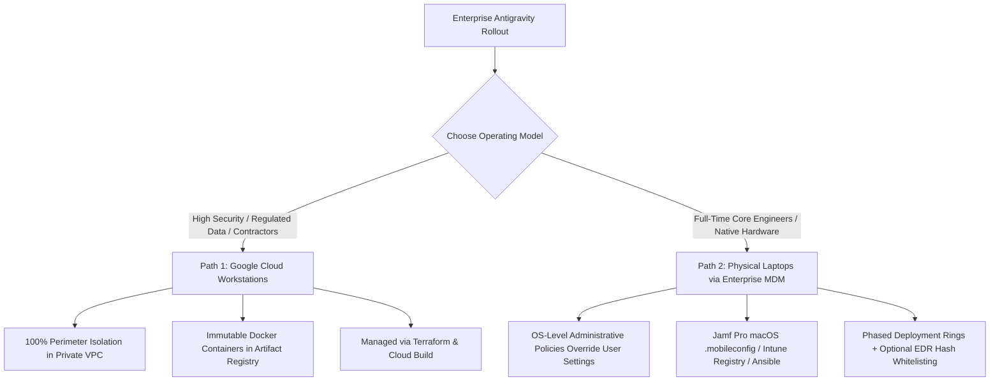
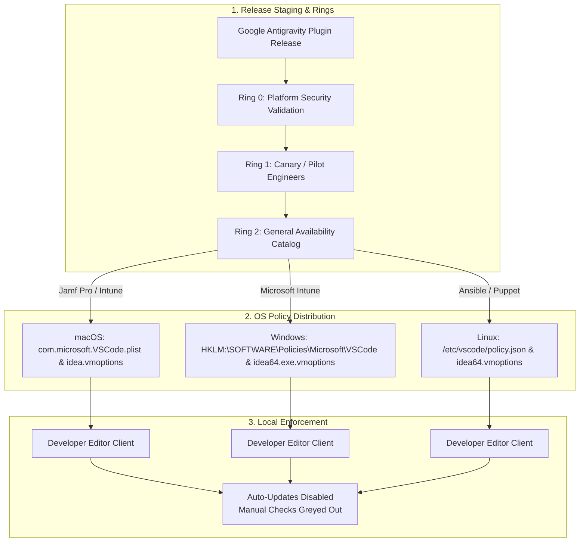

# Enterprise Governance & Version Control Guide: Google Antigravity (AGY)
*A strategic blueprint for IT administrators, CISOs, and security teams managing AI developer tooling, auto-updates, and compliance across enterprise fleets.*

---

## 1. Executive Summary & Strategic Dilemma

### The Enterprise Dilemma
Modern generative AI developer tools—including Google Antigravity (AGY)—are designed for rapid innovation, defaulting to continuous background auto-updates. In enterprise environments, however, unmanaged client updates present critical organizational risks:
* **Compliance & Audit Violations**: Tooling updates can introduce unauthorized features, modified data telemetry, or changed network egress paths that violate SOC 2, ISO 27001, HIPAA, or internal change control policies.
* **Developer Environment Breakage**: Silent background updates can introduce breaking CLI flags, alter language server dependencies, or cause unexpected incompatibilities with corporate proxies and VPNs.
* **Configuration Drift**: Without centralized version pinning, different engineers across the organization end up running different software versions, complicating debugging and support.

### The Objective
This guide provides platform teams and security administrators with a deterministic framework to:
1. **Completely disable client-side background auto-updates** across VS Code and JetBrains IDE environments.
2. **Centrally lock and manage Antigravity versions** using existing enterprise device management (MDM) fleet tooling (Jamf Pro, Microsoft Intune, Ansible).
3. **Establish a phased release ring governance process** (Ring 0 / Ring 1 / Ring 2) to validate new releases before fleet-wide general availability.

> [!NOTE]
> **Enterprise Scope & Compliance Notice**:  
> This guide covers enterprise deployment and version control of Antigravity (AGY) across **Google Cloud Workstations**, the official **VS Code extension** (`Google.google-antigravity`), and the official **JetBrains plugin**. It specifically **does not cover the standalone Antigravity IDE application**, which is a consumer preview product and is not covered under the Google Cloud Business Associate Agreement (BAA) or enterprise commercial terms.

---

## 2. Strategic Decision Matrix: Choosing Your Deployment Model

Enterprise security and platform teams have two primary models for deploying and version-controlling Antigravity:



### Core Comparison Dimensions

| Dimension | Google Cloud Workstations | Physical Laptops via Enterprise MDM |
| :--- | :--- | :--- |
| **Data Governance & Exfiltration** | **100% Perimeter Isolation**. The developer's physical machine operates purely as a display terminal. Source code, secrets, and agent interactions remain strictly within your private Google Cloud VPC perimeter. | **Shared Boundary**. Source code and configuration files reside on physical local storage. Local policies act as managed guardrails unless paired with strict EDR application hash whitelisting. |
| **Environment Determinism** | **Bit-for-Bit Identical**. Every developer runs from an immutable container image hosted in Artifact Registry. Toolchains, extensions, and configurations are guaranteed consistent across the entire fleet. | **Fleet Variation**. Prone to configuration drift across operating system versions, local environment variables, and user-level customizations. |
| **Mobility & Offline Access** | **Always-Connected**. Requires an active internet connection to access the remote workstation instance. | **Hybrid Offline**. Developers can view, edit, and compile code locally without internet. However, **all Antigravity AI capabilities require internet** to reach Google Cloud foundation models. |
| **Operational & Change Management** | **Managed as Code (IaC)**. Managed via Terraform and Cloud Build. Releasing an update means publishing a new container tag to Artifact Registry, updating the workstation configuration, and cycling instances. | **Centralized IT Policies**. Managed by corporate IT via `.mobileconfig` profiles, Intune PowerShell remediation scripts, and phased deployment rings. |

### How to Decide
* **Choose Cloud Workstations if**: You are provisioning environments for contractors, offshore development teams, or projects handling high-value intellectual property, sensitive financial/healthcare data, or regulated compliance workloads that prohibit corporate code on endpoints. *(See the companion [Cloud Workstations Deployment Guide](cloud_workstations_deployment_guide.md) for full setup).*
* **Choose Local MDM if**: You are supporting full-time core engineers who need local editor workflows, and whose physical endpoints are already protected by corporate Endpoint Detection and Response (EDR) agents.

---

## 3. Disabling Auto-Updates: The Core Mechanism

Developer IDEs prioritize configurations in a specific hierarchy:
1. **OS-Level Administrative / Machine Policies** (Highest priority — locked by IT)
2. **Workspace / Folder Settings** (`.vscode/settings.json`)
3. **User Settings** (`~/.config/Code/User/settings.json` or `%APPDATA%` — editable by the developer)

> [!CAUTION]
> **Never rely on user-level settings files** for enterprise compliance. If an IT team distributes settings to `~/.config/Code/User/settings.json`, any developer can overwrite, modify, or delete them.

To reliably prevent auto-updates, MDM tools must write directly to **OS-level administrative policy stores**. When injected at this layer, the IDE disables background update checking and greys out manual update options in the user interface.

### The Required Policy Configuration
The following settings must be enforced across all client environments:

```json
{
  "update.mode": "none",
  "extensions.autoCheckUpdates": false,
  "extensions.autoUpdate": false,
  "app.autoCheckUpdates": false
}
```

* `"update.mode": "none"`: Completely disables editor background application update checks and downloads.
* `"extensions.autoCheckUpdates": false`: Prevents the editor from polling extension marketplaces for new versions.
* `"extensions.autoUpdate": false`: Disables automatic installation of extension updates.
* `"app.autoCheckUpdates": false`: Blocks auxiliary update checking daemons.

---

## 4. Enterprise MDM Implementation Blueprints



### Validated Enterprise Policy Matrix

| Operating System | Target IDE | Configuration File / Registry Path | Setting / Directive | Verified Behavior in GUI |
| :--- | :--- | :--- | :--- | :--- |
| **Windows** | Visual Studio Code | `HKLM:\SOFTWARE\Policies\Microsoft\VSCode` | `UpdateMode` = `"none"` (String)<br>`ExtensionsAutoUpdate` = `0` (DWORD) | In Settings, `@hasPolicy` displays the managed policy badge; `update.mode` is locked to `none`. |
| **Windows** | IntelliJ IDEA | `<install_dir>\bin\idea64.exe.vmoptions` | `-Dide.no.platform.update=true` | Settings displays: *"IDE updates are managed externally by (unknown)"*. Automatic platform checks and channel dropdowns are removed. |
| **Linux** | Visual Studio Code | `/etc/vscode/policy.json`<br>*(File permissions: `0644`)* | `{"UpdateMode": "none"}`<br>*(Requires PascalCase key)* | In Settings, `@hasPolicy` displays the managed policy badge; `update.mode` is locked to `none`. |
| **Linux** | IntelliJ IDEA | `<install_dir>/bin/idea64.vmoptions` | `-Dide.no.platform.update=true` | Settings displays: *"IDE updates are managed externally by (unknown)"*. Checking for updates confirms platform updates are managed externally. |
| **macOS** | Visual Studio Code | `/Library/Managed Preferences/com.microsoft.VSCode.plist` | `UpdateMode` = `"none"` | In Settings, `update.mode` displays: *"This setting is managed by your organization and cannot be changed"*. |
| **macOS** | IntelliJ IDEA | `~/Library/Application Support/JetBrains/IntelliJIdea*/idea.vmoptions` | `-Dide.no.platform.update=true` | Settings displays: *"IDE updates are managed externally by (unknown)"*. Platform updates suppressed. |


### 1. macOS: Jamf Pro / Munki (`DisableAntigravity2AutoUpdate.sh` & `.mobileconfig`)

On macOS, configuration profiles targeting `com.google.antigravity` write to `/Library/Managed Preferences/com.google.antigravity.plist`. However, because Antigravity 2.0 does not yet bind OS-level preferences, enterprise version lock is enforced via a Jamf Pro / Munki post-install script that sets system environment variables and sinkholes update traffic.

**Post-Install Script (`DisableAntigravity2AutoUpdate.sh`)**:
```bash
#!/bin/bash
DOMAIN="antigravity-cli-auto-updater-974169037036.us-central1.run.app"
SINKHOLE_ENTRY="0.0.0.0 ${DOMAIN}"
ENV_VAR_LINE="export AGY_CLI_DISABLE_AUTO_UPDATE=1"

# 1. Enforce environment variable for zsh and bash
for env_file in "/etc/zshenv" "/etc/profile"; do
    touch "$env_file" && chmod 644 "$env_file"
    if ! grep -q "AGY_CLI_DISABLE_AUTO_UPDATE" "$env_file"; then
        echo "$ENV_VAR_LINE" >> "$env_file"
    fi
done

# 2. Add DNS sinkhole to /etc/hosts
if ! grep -q "$DOMAIN" /etc/hosts; then
    echo "$SINKHOLE_ENTRY" >> /etc/hosts
fi
dscacheutil -flushcache
killall -HUP mDNSResponder 2>/dev/null || true
```

**Configuration Profile Payload (`com.google.antigravity.mobileconfig`)**:
```xml
<?xml version="1.0" encoding="UTF-8"?>
<!DOCTYPE plist PUBLIC "-//Apple//DTD PLIST 1.0//EN" "http://www.apple.com/DTDs/PropertyList-1.0.dtd">
<plist version="1.0">
<dict>
    <key>PayloadContent</key>
    <array>
        <dict>
            <key>PayloadType</key>
            <string>com.google.antigravity</string>
            <key>PayloadIdentifier</key>
            <string>com.google.antigravity.policy</string>
            <key>PayloadUUID</key>
            <string>B2C3D4E5-F6A7-4B8C-9D0E-1F2A3B4C5D6E</string>
            <key>PayloadVersion</key>
            <integer>1</integer>
            <key>PayloadEnabled</key>
            <true/>
            <!-- Disables application & extension updates -->
            <key>update.mode</key>
            <string>none</string>
            <key>extensions.autoCheckUpdates</key>
            <false/>
            <key>extensions.autoUpdate</key>
            <false/>
            <key>app.autoCheckUpdates</key>
            <false/>
        </dict>
    </array>
    <key>PayloadDisplayName</key>
    <string>Google Antigravity 2.0 Corporate Version Control Policy</string>
    <key>PayloadIdentifier</key>
    <string>com.google.antigravity.profile</string>
    <key>PayloadType</key>
    <string>Configuration</string>
    <key>PayloadUUID</key>
    <string>C3D4E5F6-A7B8-4C9D-0E1F-2A3B4C5D6E7F</string>
    <key>PayloadVersion</key>
    <integer>1</integer>
</dict>
</plist>
```

---

### 2. Windows: Microsoft Intune (PowerShell / Intune Remediation)

On Windows endpoints, deploy via Microsoft Intune Proactive Remediation or PowerShell script to enforce the machine-level environment variable and sinkhole auto-update traffic:

**Remediation Script (`DisableVSCodeAutoUpdate.ps1`)**:
```powershell
# 1. Enforce System-wide Environment Variable
$EnvVarName = "AGY_CLI_DISABLE_AUTO_UPDATE"
$Target = [System.EnvironmentVariableTarget]::Machine
[System.Environment]::SetEnvironmentVariable($EnvVarName, "1", $Target)

# 2. Add DNS sinkhole entry in hosts file
$HostsPath = "$env:SystemRoot\System32\drivers\etc\hosts"
$Domain = "antigravity-cli-auto-updater-974169037036.us-central1.run.app"
$SinkholeEntry = "0.0.0.0 $Domain"

if (Test-Path $HostsPath) {
    $Content = Get-Content -Path $HostsPath
    if ($Content -notcontains $SinkholeEntry) {
        Add-Content -Path $HostsPath -Value "`n# Antigravity 2.0 Auto-Updater Sinkhole`n$SinkholeEntry" -Force
    }
}

# 3. Enforce Visual Studio Code Enterprise Update Lockdown (Registry GPO)
$VSCodePolicyKey = "HKLM:\SOFTWARE\Policies\Microsoft\VSCode"
if (!(Test-Path $VSCodePolicyKey)) {
    New-Item -Path $VSCodePolicyKey -Force | Out-Null
}
Set-ItemProperty -Path $VSCodePolicyKey -Name "UpdateMode" -Value "none" -Type String -Force
Set-ItemProperty -Path $VSCodePolicyKey -Name "ExtensionsAutoUpdate" -Value 0 -Type DWord -Force
Set-ItemProperty -Path $VSCodePolicyKey -Name "ExtensionsAutoCheckUpdates" -Value 0 -Type DWord -Force

# 4. Enforce IntelliJ IDEA Platform Update Lockdown (idea64.exe.vmoptions)
$IntelliJDirs = Get-ChildItem -Path "C:\Program Files\JetBrains" -Directory -ErrorAction SilentlyContinue | Where-Object { $_.Name -like "*IntelliJ*" }
foreach ($dir in $IntelliJDirs) {
    $vmOptionsPath = Join-Path $dir.FullName "bin\idea64.exe.vmoptions"
    if (Test-Path $vmOptionsPath) {
        $vmOptionsContent = Get-Content $vmOptionsPath
        if ($vmOptionsContent -notcontains "-Dide.no.platform.update=true") {
            Add-Content -Path $vmOptionsPath -Value "`n-Dide.no.platform.update=true" -Force
        }
    }
}
```

---

### 3. Linux: Ansible Playbook

On Linux workstations, deploy system-wide environment variables, a DNS sinkhole, VS Code `/etc/vscode/policy.json`, and IntelliJ `idea64.vmoptions` via Ansible:

```yaml
- name: Enforce Antigravity 2.0 Version Lock on Linux Developer Endpoints
  hosts: workstations
  become: true
  tasks:
    - name: Set system-wide environment variable AGY_CLI_DISABLE_AUTO_UPDATE
      ansible.builtin.lineinfile:
        path: /etc/environment
        regexp: '^AGY_CLI_DISABLE_AUTO_UPDATE='
        line: 'AGY_CLI_DISABLE_AUTO_UPDATE=1'
        state: present

    - name: Deploy profile script to export AGY_CLI_DISABLE_AUTO_UPDATE
      ansible.builtin.copy:
        dest: /etc/profile.d/antigravity-lockdown.sh
        owner: root
        group: root
        mode: '0644'
        content: |
          #!/bin/sh
          export AGY_CLI_DISABLE_AUTO_UPDATE=1

    - name: Add DNS sinkhole entry to /etc/hosts for auto-updater endpoint
      ansible.builtin.lineinfile:
        path: /etc/hosts
        regexp: 'antigravity-cli-auto-updater-974169037036\.us-central1\.run\.app'
        line: '0.0.0.0 antigravity-cli-auto-updater-974169037036.us-central1.run.app'
        state: present

    - name: Ensure /etc/vscode directory exists
      ansible.builtin.file:
        path: /etc/vscode
        state: directory
        owner: root
        group: root
        mode: '0755'

    - name: Deploy Visual Studio Code enterprise policy (/etc/vscode/policy.json)
      ansible.builtin.copy:
        dest: /etc/vscode/policy.json
        owner: root
        group: root
        mode: '0644'
        content: |
          {
            "UpdateMode": "none"
          }

    - name: Ensure IntelliJ IDEA platform updates are disabled in idea64.vmoptions
      ansible.builtin.lineinfile:
        path: /opt/idea-IC/bin/idea64.vmoptions
        line: '-Dide.no.platform.update=true'
        state: present
      failed_when: false
```

---

## 5. Release Governance & Deployment Rings

To roll out updates safely without risking fleet-wide outages or unexpected regressions, organizations should adopt a phased deployment ring architecture:

```
[Google Upstream Release]
           │
           ▼
┌───────────────────────────────────────┐
│ Ring 0: Platform & SecOps Validation  │  (1-3 Days: TLS proxy inspection, CVE verification)
└───────────────────────────────────────┘
           │
           ▼
┌───────────────────────────────────────┐
│ Ring 1: Canary / Pilot Engineers      │  (1-2 Weeks: 5-10% of engineering team, language servers)
└───────────────────────────────────────┘
           │
           ▼
┌───────────────────────────────────────┐
│ Ring 2: General Availability (GA)     │  (100% Fleet: Promoted to Jamf/Intune self-service catalog)
└───────────────────────────────────────┘
```

1. **Ring 0 (Platform Security & IT Validation)**:
   * Test the candidate binary/extension against internal corporate proxies, TLS inspection certificates, and egress firewall rules.
   * Verify that authentication against Google Cloud uses authorized identity providers and scopes.
2. **Ring 1 (Canary & Pilot Engineering Cohort)**:
   * Deploy to a representative 5–10% sample of software engineers across multiple language stacks (Python, Java, Go, TypeScript).
   * Confirm that language servers, indexing, and daily IDE extensions function without conflict.
3. **Ring 2 (Fleet-Wide General Availability)**:
   * Package the approved version into the corporate self-service software portal (Jamf Self Service or Intune Company Portal).
   * Increment the mandatory minimum version in corporate compliance scripts.

---

## 6. The Local Admin Reality & EDR Whitelisting

Platform security teams must account for a fundamental security truth on physical developer hardware:
> **If developers possess local `sudo` or local administrator rights, client-side configuration files are managed guardrails—not an impenetrable security boundary.**

A user with administrative privileges can alter `/Library/Managed Preferences`, stop Intune management services, or install standalone binaries into unmanaged user directories (`~/.local/bin`).

### Production Hardening: Pairing MDM with EDR
For organizations operating in zero-trust, healthcare, or defense environments where strict binary integrity is required on local hardware:
1. **Application Hash Whitelisting**: Leverage corporate Endpoint Detection and Response (EDR) platforms (such as CrowdStrike Falcon, Microsoft Defender for Endpoint, or VMware Carbon Black).
2. **Enforce Binary Execution Policies**: Configure the EDR agent to permit execution only of binaries matching the exact SHA-256 hash of the IT-vetted Antigravity (`agy`) release.
3. **Block Unvetted Binaries**: If a developer attempts to download or run an ad-hoc or updated `agy` executable, the EDR agent terminates the process at the OS kernel level, regardless of the user's `sudo` permissions.

---

## 7. Governance Implementation Checklist

- [ ] **Model Selection**: Determine whether your workload requires Cloud Workstations (100% cloud perimeter isolation) or Local MDM (governed native endpoints).
- [ ] **Policy Distribution**: Deploy machine-level `update.mode = "none"` policies via Jamf Pro, Intune, or Ansible.
- [ ] **Verification**: Confirm in developer IDEs that automatic update checks are disabled and manual "Check for Updates" options are greyed out.
- [ ] **Pilot Ring Setup**: Establish Ring 0 (Security/Platform) and Ring 1 (Canary) device groups in your MDM catalog.
- [ ] **EDR Baseline**: If local users have admin rights and strict compliance is required, register the SHA-256 hashes of approved Antigravity binaries in your EDR platform.

---

## 8. Related Guides & Resources

* 🛠️ **Hands-on Deployment**: See the [Cloud Workstations Deployment Guide](cloud_workstations_deployment_guide.md) for Docker pre-baking, startup hooks, and supervisor auto-reloading.
* 📦 **Production Code Repository**: All Terraform modules, Dockerfile configurations, and MDM policy templates are available at [github.com/cemendes/antigravity-enterprise-rollout](https://github.com/cemendes/antigravity-enterprise-rollout).
